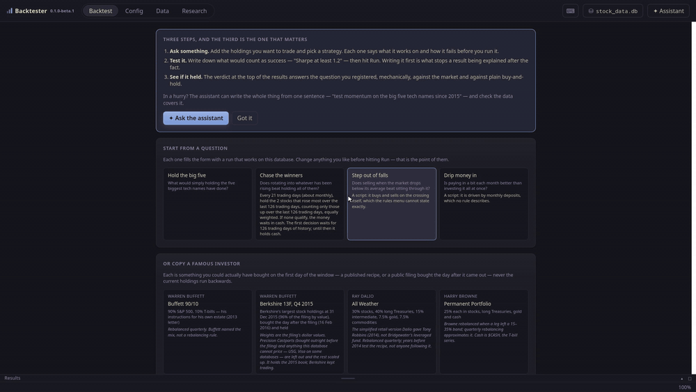

# Backtester

A backtesting engine and desktop research app for your own investing. Write
strategies in Lua or pick them from a menu, run many portfolios in parallel
over decades of US equity data in DuckDB, and get a verdict on whether the
result is real — not just a nice-looking equity curve.

**Open source under the [MIT licence](LICENSE).** Use it, fork it, take the
ideas you like into your own tools. It began as one person's research
workbench, and it shows: it is opinionated, Linux-only, and honest about its
data's flaws rather than free of them. It is not a commercial product and makes
no promise of support — but issues and pull requests are welcome (see
[Contributing](#contributing)).

**Nothing it produces is investment advice.** A backtest describes what a
strategy would have done in the past under modelling assumptions that are all,
to some degree, wrong. Past simulated performance does not predict future
returns, and the data has known defects — read
[`DATA-LICENSE.md`](DATA-LICENSE.md) before trusting a number.

## Demo



One minute at 1.5× speed: copy Ray Dalio's All Weather portfolio and run it
against the S&P 500, read the verdict and the equity curve, open the Lua script
behind it, query the prices in SQL, and read NVIDIA's latest earnings release
straight from SEC EDGAR. Full-quality recording:
[`docs/demo.mp4`](docs/demo.mp4) (download it; GitHub can't play it in the
browser).

## What it does

- **Strategies three ways** — a form with starter questions and famous-investor
  portfolios, a rules menu, or Lua scripts with a documented API and a
  library of read-only examples ([`strategies/`](strategies/README.md)).
- **Results you can argue with** — register a hypothesis before you run, and
  get a mechanical verdict against the market and against plain buy-and-hold,
  with significance tests, deflated Sharpe, out-of-sample splits, walk-forward,
  parameter sweeps and a robustness battery.
- **Realistic frictions** — commissions, slippage, deposits and withdrawals,
  opt-in shorting with borrow cost and margin calls, and delisting haircuts.
- **Data that avoids the usual biases** — delisted companies, recycled ticker
  symbols split apart, fundamentals lagged to their real SEC filing dates,
  point-in-time S&P 500 membership, and total-return benchmarks back to 1927.
- **Research in the same window** — a read-only SQL console over the whole
  database, and every company's SEC filings and economic releases, read in-app.
- **An AI assistant** that knows the engine — Claude, or local models through
  Ollama — and can write a config from one sentence.
- **Free data, no API keys** — `scripts/build_db.py` builds the whole database
  from public sources in one command.

## Quick start

You need Go 1.25+, Python 3 and, for the desktop app,
[Wails v2](https://wails.io) with WebKitGTK 4.1 (Linux only for now).

```bash
# 1. Build a database (a few minutes; no keys needed)
pip install -r requirements.txt
python3 scripts/build_db.py --db stock_data.db

# 2a. The desktop app
cd ui && wails build -tags webkit2_41 && ./build/bin/ui

# 2b. Or the command line, which runs config.toml
cd src && go run main.go
```

Details, including building from a fresh clone and where the app looks for its
files: [Installation and setup](docs/installation.md).

## Documentation

| | |
|---|---|
| [Installation and setup](docs/installation.md) | requirements, building, where files are found, release contents |
| [Data](docs/data.md) | building the database, benchmarks, fundamentals, delistings, keeping prices current |
| [Configuration](docs/configuration.md) | every `config.toml` key: costs, cash flows, rules, shorting, validation, sweeps, `[Output]` |
| [Command line](docs/cli.md) | running backtests, signal scans, event studies and checks |
| [The desktop app](docs/app.md) | the Backtest and Research tabs, and the AI assistant |
| [Architecture](docs/architecture.md) | how the engine fits together and the project layout |
| [Lua strategy API](strategies/README.md) | writing your own strategy |
| [`CHANGELOG.md`](CHANGELOG.md) | what each release changed |

## Licence

| File | Covers |
|---|---|
| [`LICENSE`](LICENSE) | The software — code, Lua strategy library and frontend. **MIT.** |
| [`DATA-LICENSE.md`](DATA-LICENSE.md) | The market data. **Not** open source: some sources forbid redistribution, so a fork may ship the code but not a database — point people at [`scripts/build_db.py`](docs/data.md#build-your-own-database). Also the inventory of known data defects. |
| [`THIRD-PARTY-NOTICES.txt`](THIRD-PARTY-NOTICES.txt) | The Go modules and npm packages compiled into the binary, all permissive (MIT, BSD, ISC, Apache-2.0). |

## Contributing

Issues and pull requests are welcome; there is no roadmap you have to fit.
Before opening a PR:

- **Keep the gate green.** `go build ./...`, `go vet ./...` and
  `go test ./... -count=1` must all pass (about a minute; `-short` is the quick
  loop). Script changes: `python3 -m pytest scripts -q`.
- **A changed default must not change old numbers.** New config fields default
  to a zero value that reproduces the previous behaviour exactly.
- **Document what users can see.** A config key, metric, Lua global or result
  field belongs in [`docs/`](docs/configuration.md), and in `appReference` in
  `ui/chat.go` — that prompt is the in-app assistant's entire knowledge of the
  engine. Tests enforce it for `Metrics`, `PortfolioConfig` and `CostConfig`.
- **Exercise UI changes, don't just compile them.** Add or extend a case in
  `ui/frontend/src/smoke.tsx`; it mounts components inside `go test`.
- **A dependency change regenerates the notices** with
  `python3 scripts/gen_notices.py`.
- **Never commit data** (`stock_data.db` and anything derived from it) or the
  `ui/ui` build artifact.
- **Ports are especially welcome.** macOS and Windows have never been built.

By contributing you agree your contribution is licensed under the MIT licence.
